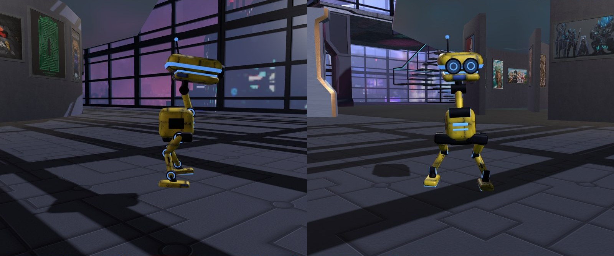

# darkride-bots

Little walking robots for your Darkride (or Overte-family) world: a crew of droids that wander your domain on their
own, climb stairs, peer over edges, look at things, greet visitors and each other, sit, peck, kick and roll, answer
you in beeps when you talk to them, and, for the small ones, rocket up to the upper floors.

They walk with real robot motion: every step, turn, sit and roll was recorded from the trained walking and trick
policies of Pollen Robotics' open-source [Microduck](https://github.com/pollen-robotics/microduck_rl) robot, run in
the MuJoCo physics simulator. The bots' bodies are our own, built from clean parts on the Microduck's skeleton, in as
many styles as you like, weathered like Star Wars droids from factory-fresh to beaten up.



## What you get

- **The runtime** (`bot/`): the script your domain runs for each bot (`duck-bot.js` loading `duck-brain.js`), the
  recorded walks and moves (`duck-cycles.json`), and the bots' voices (`sounds/`, synthesised beeps and chirps).
- **A bot builder** (`tools/build_bots.py`): makes each bot's model from a roster (`bots.json`): size, colours, wear,
  head shape, eyes, antennas, fins, crest, jaw, rocket pods.
- **A map builder** (`tools/build_nav.py`): makes the bots' walkable map of your world from its entities: floors on
  every level, stairs, walls, drops, rocket hops and things worth looking at.
- **A packager** (`tools/package.py`): builds the folder of files to upload to your asset server.
- **The motion recorder** (`motions/`): if you want to record new moves from Pollen's policies.
- **Tests** (`tests/`): Interface scripts that photograph the bots, check their joints, make them talk and hop.

## Quick start

1. Python 3.10+ with the tools' packages: `pip install -r requirements.txt`.
2. Copy `examples/bots.json` and make the bots yours (docs/designing-bots.md), and copy `examples/world.json` and
   point it at your world (docs/adding-to-your-world.md).
3. Build the folder to upload:
   ```
   python tools/package.py --roster my-bots.json --world my-world.json --out dist/bot
   ```
4. Upload `dist/bot` to your asset server, so its files sit together at one URL.
5. In your domain's settings (Content > Scripts > Persistent Scripts), add `duck-bot.js` at that URL with one
   instance per bot, and make sure the domain has an assignment client free for each.

A minute later the bots hatch and start exploring.

## Documents

- [How it works](docs/how-it-works.md): agents, the brain, the map, the motion, listening, rockets.
- [The skeleton](docs/skeleton.md): the bones, their frames, the bind and rest poses, and what a viewer expects.
- [Designing bots](docs/designing-bots.md): the roster, the styles, the weathering, and making your own parts.
- [Adding them to your world](docs/adding-to-your-world.md): the world config, the map, uploading, the domain, costs.
- [Recording motions](docs/motions.md): from Pollen's policies to duck-cycles.json.
- [Troubleshooting](docs/troubleshooting.md): what went wrong for us, and why.

## Credits and licences

- The bots' skeleton and their recorded motion come from Pollen Robotics' Microduck: its MJCF robot description and
  its trained policies, both Apache-2.0 (https://github.com/pollen-robotics/microduck_rl,
  https://huggingface.co/spaces/pollen-robotics/microduck-simulator). See NOTICE.
- Pollen's 3D meshes (CC BY-NC-SA 4.0) are **not** included or needed: the bots' bodies are built here.
- Everything else (the code, models, textures and sounds) is by Martin Allerton, under the licence in LICENSE.
