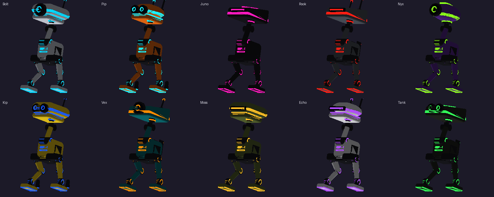

# Designing bots



## The roster (bots.json)

```json
{
  "about": "…",
  "channel": "darkride.bots",
  "hatch": "ground",
  "areas": {
    "office": {"x": [-24.5, -5.0], "y": [2.5, 6.5], "z": [-44.5, -31.5], "hatch": [-13.1, 3.6, -38.9]},
    "ground": {"x": [-40, 40], "y": [-3.0, -1.5], "z": [-60, 20]}
  },
  "bots": [
    {"id": "bolt", "name": "Bolt", "size": 1.0, "shell": [0.86, 0.88, 0.92], "accent": [0.0, 0.85, 1.0],
     "glow": 0.8, "metal": 0.5, "wear": 0.25,
     "style": {"jaw": true, "head": "loaf", "eyes": "lens", "antennas": 1}}
  ]
}
```

Top level:
- `channel` (optional): the message channel the bots share; give two crews in one domain different ones.
- `hatch` (optional): an area where bots without a home start (otherwise anywhere open on the map).
- `hearing` (optional): the URL of the speech service (tools/hearing.py), normally `http://127.0.0.1:40195/hear`;
  without it bots don't take spoken commands.
- `unit_prefix` (optional): the letters of the unit numbers stencilled on them (default DR).
- `areas`: boxes in world coordinates (metres), `x`, `y`, `z` as `[min, max]`; `hatch` (optional) is a spot in it to
  start at.

Each bot:

| field | what | default |
|---|---|---|
| `id` | short lower-case name: the files are `duck-<id>.*` | (needed) |
| `name` | its name | (needed) |
| `size` | scale against the standard bot (about 1 m tall); 0.5 to 1.5 look right | 1 |
| `shell`, `accent` | colours, 0-1 RGB: its paint and its glowing parts | (needed) |
| `glow` | how brightly the accent glows, 0-1 | 0.8 |
| `metal` | how metallic the paint is, 0-1 | 0.4 |
| `wear` | 0 factory-fresh to 1 beaten up | 0.3 |
| `paint2` | a second paint for some panels, RGB | from the accent |
| `unit` | the stencilled unit number | the roster's `unit_prefix` (default DR) and a number |
| `climbs` | `false` keeps it off stairs | true |
| `rockets` | `true`: rocket pods, and it hops between floors at the map's rocket hops | false |
| `home` | an area it never leaves | none |
| `obedience` | how often it does what it's told, 0-1 | 0.7 |
| `style` | its look (below) | |

Copies of the script take bots in roster order: with three running, the first three are about.

## Bouncers and other roles

A bot with a `role` doesn't wander and isn't taken by the wandering copies: it runs from its own persistent script,
`bot-<id>.js` (build_bots.py writes it), one instance. The one role so far is `"bouncer"`: it guards a post, watches
everyone within 15 m, swivels to follow them and turns to face anyone well off to the side, challenges arrivals
within 12 m, answers anyone who talks to it, shifts its feet and mutters now and then.

| field | what |
|---|---|
| `role` | `"bouncer"` |
| `post` | `[x, y, z]`: where it stands |
| `facing` | which way it faces there (radians; 0 faces -z, π/2 faces -x) |
| `recognise` | names it welcomes rather than challenges (any part of a visitor's display name, any case) |
| `voice` | its lines, `{"name": "what it says"}`: tools/make_voice.py speaks them into `sounds/<name>.wav` |
| `lines` | which to say when: `welcome` (names), `challenge` (sequences of names, one picked per arrival; sounds like `countdown` work too), `reply` (when spoken to), `idle` (muttered when nobody's about) |

`"style": {"build": "bouncer"}` builds it as a big armoured sentry (ED-209 crossed with an ABC Warrior): its hull
low on its shoulders with a visor slit, a twin cannon and a rocket pod, armoured legs with hydraulic rams, clawed feet,
rivets, exhausts and a sensor mast, and no lights. Give it a big `size` (3 is about 3 m) and plenty of `wear`.

See the Madders Place roster's Warden for a full example.

## Styles

| style | choices |
|---|---|
| `head` | `loaf` (a rounded box), `dome` (an ellipsoid), `wedge` (angular, its front sloping down like a visor) |
| `eyes` | `lens` (one round eye), `visor` (a glowing slit), `twin` (two round eyes) |
| `antennas` | 0, 1 or 2, with glowing tips |
| `jaw` | `true`: a hinged lower jaw with a glowing mouth, opening as it beeps |
| `fins` | `true`: two fins on its back with glowing tips |
| `crest` | `true`: a glowing ridge along the top of its head |
| `chest` | `false` to leave off the chest light |

Every bot also has a glowing band round its head (following the head's shape), glowing rings on its hip, knee and
ankle hubs, and glowing soles.

## Weathering

`tools/weathering.py` paints each bot two textures, box-projected onto it: its **shell** and its **dark metal**. The
shell: its colour with a little fade, panels with dark panel lines and grime gathered along them, some panels in its
second paint (think R2-D2's blue), its unit number stencilled on, and by its `wear`: hazard stripes, paint chips
along the panel edges (down to bare metal or primer), scratches, grime, scorch marks and rust streaks running down.
Wear 0 is fresh from the factory; 0.5 a working droid; 0.9 has seen some things.

## Building and previewing

```
python tools/build_bots.py --roster my-bots.json --out dist/bot            # every bot
python tools/build_bots.py --roster my-bots.json --out dist/bot bolt pip   # just these
```

Each bot gets `duck-<id>.glb` (about 15-20 thousand triangles), `duck-<id>.fst`, and its two textures.

## Making your own parts

The parts are made in `design()` in `tools/build_bots.py`: a list of `(mesh, material, bone, smooth)`, each a trimesh
mesh **in the rest pose** (see docs/skeleton.md for where everything is), the material one of `shell`, `dark`,
`glow` or `lens`, and the bone it rides on. Helpers: `rounded_box`, `ellipsoid`, `capsule`, `tapered`, `disc`,
`ring`, `box`, `band` (a slice of a shell, slightly larger: a band that hugs it), `ridge` (a strip along a shell's
top), `top_at` (a shell's height at x, z). `sk.pos(bone)` and `sk.axis(bone)` give a bone's rest position and the axis
it turns about.

To add a style, read it from `style` in `design()` and add parts; to add a whole new kind of bot on the same skeleton
(a big bouncer, say), write another design function. Keep each part on the bone that should carry it: anything on
`head_roll` moves with the head, on `jaw` with the jaw, on `left_knee` with the shin.

A bot's model must keep the skeleton exactly: the same nodes in the same order, the jaw added last, and its .fst's
joint list in the viewer's order. build_bots.py does all that for you.
